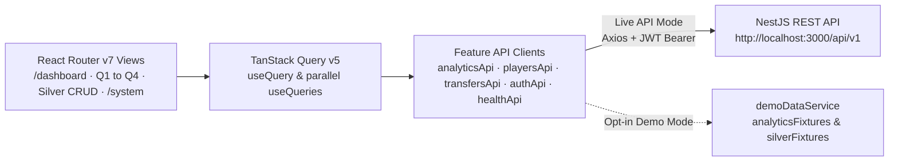

<div align="center">


# MercatoIQ Frontend

**European Football Performance & Financial Intelligence Web Application**  
*Interactive Moneyball analytics across the UEFA Champions League & Top 5 European Leagues, paired with Silver domain management and real-time pipeline controls.*

[](https://react.dev/)
[](https://www.typescriptlang.org/)
[](https://vite.dev/)
[](https://tailwindcss.com/)
[](https://tanstack.com/query/latest)
[](https://recharts.org/)
[](https://vitest.dev/)

[Architecture](#architecture) · [Fixed Top-5 League Charts](#fixed-top-5-league-chart-grids) · [Routes & Features](#routes--features) · [API Integration](#backend-api-integration) · [Quick Start](#quick-start) · [Environment](#environment-variables) · [Project Structure](#project-structure) · [Scripts & Testing](#scripts--testing)

</div>

## Architecture

The frontend is a **React 19 + TypeScript 5.8** single-page application built with **Vite 6** and **Tailwind CSS v4**. Route views in `src/app/router.tsx` are lazy-loaded via `React.lazy`, while `vite.config.ts` splits third-party dependencies into dedicated Rollup vendor chunks (`vendor-react`, `vendor-router`, `vendor-query`, `vendor-charts`, `vendor-i18n`, `vendor-icons`).

- **Server State:** **TanStack Query v5** (`useQuery` and parallel `useQueries` with `keepPreviousData`) manages caching, filtering, and pagination across analytics and Silver CRUD views.
- **HTTP & Auth Layer:** A centralized Axios client (`src/shared/api/httpClient.ts`) injects stored JWT Bearer tokens (`mercatoiq_token`), normalizes NestJS `ValidationPipe` errors into `AppApiError`, and dispatches `mercatoiq:unauthorized` on `401` responses (outside `/auth/*`) to trigger automatic logout.
- **Opt-In Demo Mode:** `DemoModeContext` allows switching seamlessly between the live NestJS API and an offline mock service (`demoDataService` backed by `analyticsFixtures.ts` and `silverFixtures.ts`).



## Fixed Top-5 League Chart Grids

Across `/dashboard` and all four Gold analytical pages (`/club-roi`, `/scouting`, `/ucl-vs-domestic`, `/super-subs`), charts are organized into fixed multi-league grids powered by `LeagueChartsGrid` and parallel `use*ByLeagueQueries` hooks:

- `useClubRoiByLeagueQueries`, `useScoutingU23ByLeagueQueries`, `useUclVsDomesticByLeagueQueries`, and `useSuperSubsByLeagueQueries` fetch series in parallel for the Top 5 European leagues:
  - **Premier League (`GB1`)**
  - **LaLiga (`ES1`)**
  - **Serie A (`IT1`)**
  - **Bundesliga (`L1`)**
  - **Ligue 1 (`FR1`)**
- Selecting a league in `AnalyticsFilterBar` or clicking **Focus** on a league card filters the grid to isolate that competition without mutating chart definitions; **Season**, **Position**, and **Club ID** filters update all visible league charts simultaneously, and multi-season clubs are deduplicated when viewing `All seasons`.
- Custom data visualizations in `src/shared/components/charts/` include:
  - `StripedBarChart` (angled X-axis labels, custom ROI ticks, tooltip rows)
  - `CapsuleComparisonChart` (bench vs. starter G+A/90 capsule comparison with interactive hover tooltips)
  - `StripedProgressBar`, `ChartTooltip`, and `PlayerValuationChart` (market value trajectory)

## Routes & Features

| Route | View | Access | Capabilities |
| :--- | :--- | :---: | :--- |
| `/` | `LandingPage` | Public | Product overview, live entry points, theme & language controls |
| `/about`, `/contact`, `/privacy`, `/terms` | Info & Legal | Public | Platform background, contact info, privacy & terms pages |
| `/login`, `/register` | Auth Pages | `GuestRoute` | Email/password JWT auth with inline validation, forgot-password modal, optional Google Identity Services / OAuth redirect |
| `/auth/callback` | `AuthCallbackPage` | Public | OAuth redirect token & user session ingestion |
| `/dashboard` | `DashboardPage` | AppShell | Gold KPIs, freshness timestamp, Fixed Top-5 League Club ROI chart grid, `/command` Explorer Command Bar (`/club-roi`, `/scouting-u23`, `/ucl-vs-domestic`, `/super-subs`, `/players`, `/transfers`, or player name search), snapshot progress bars, Q2/Q4 preview cards |
| `/club-roi` | `ClubRoiPage` | AppShell | **Q1 · Club Transfer ROI:** Fixed Top-5 League ROI bar charts, paginated table, CSV export |
| `/scouting` | `ScoutingU23Page` | AppShell | **Q2 · ML U23 Scouting:** Fixed Top-5 League market value vs. ML fair value scatter charts, undervalued ratio rankings, CSV export |
| `/ucl-vs-domestic` | `UclVsDomesticPage` | AppShell | **Q3 · UCL vs Domestic:** Fixed Top-5 League diverging Goals/90 delta charts, paginated comparison table, CSV export |
| `/super-subs` | `SuperSubsPage` | AppShell | **Q4 · Super-Subs:** Fixed Top-5 League `CapsuleComparisonChart` (bench vs. starter G+A/90 with hover tooltips), Super-Sub Score leaderboard, CSV export |
| `/players`, `/players/:id` | `PlayersPage`, `PlayerDetailPage` | AppShell | **Silver Players CRUD:** Debounced search, multi-filter bar, paginated table (`limit <= 100`), inline-validated create/edit modal matching NestJS `ValidationPipe` (`forbidNonWhitelisted`), valuation trajectory chart, transfer history, delete confirmation, CSV export |
| `/transfers` | `TransfersPage` | AppShell | **Silver Transfers CRUD:** Multi-filter paginated table, transfer detail modal, inline-validated create/edit modal, delete confirmation, CSV export |
| `/profile` | `ProfilePage` | `ProtectedRoute` | Authenticated user account & session details |
| `/system`, `/admin` | `SystemPage` | AppShell / `admin` (`ProtectedRoute`) | Live `GET /health` latency & status check, Live API vs. Demo Mode switcher, RBAC role display, and admin-only `POST /admin/pipeline/trigger` (requires backend `OPS-01` module, currently planned on backend `develop`; `/admin` enforces `allowedRoles={['admin']}`) |

### Cross-Cutting UX
- **Bilingual UI (`i18next`):** English default with live English / French (`EN` / `FR`) switching persisted in `localStorage`, plus locale-aware EUR currency, compact number, and date formatting.
- **Dual Theme (`ThemeContext`):** Instant toggle between `data-theme="light"` (editorial canvas) and `data-theme="dark"` (obsidian/lime contrast).
- **CSV Export (`exportToCsv`):** One-click export across all Q1 to Q4 analytics views, Players, and Transfers.
- **Responsive Design:** Adaptive grid and navigation layout verified across desktop and `390px` mobile viewports.

## Backend API Integration

All requests target `VITE_API_BASE_URL` (default: `http://localhost:3000/api/v1`) via `httpClient`.

| Module | Endpoints Used | Notes |
| :--- | :--- | :--- |
| `healthApi.ts` | `GET /health` | Measures round-trip latency and displays service version/timestamp on `/system` |
| `authApi.ts` | `POST /auth/login`, `POST /auth/register`, `POST /auth/google` | Stores JWT access token & user profile (`user` or `admin`) |
| `analyticsApi.ts` | `GET /analytics/kpis`, `/analytics/club-roi`, `/analytics/scouting-u23`, `/analytics/ucl-vs-domestic`, `/analytics/super-subs` | Supports season, `competition_id` / `domestic_competition_id`, position, `club_id`, and pagination params |
| `playersApi.ts` | `GET /players`, `GET /players/:id`, `POST /players`, `PATCH /players/:id`, `DELETE /players/:id` | Supports `PlayerFormModal` CRUD & `PlayerDetailPage` profile view |
| `transfersApi.ts` | `GET /transfers`, `GET /transfers/:id`, `POST /transfers`, `PATCH /transfers/:id`, `DELETE /transfers/:id` | Supports `TransferFormModal` CRUD & `TransferDetailModal` |
| `SystemPage.tsx` | `POST /admin/pipeline/trigger` | Admin-only action targeting the planned backend `OPS-01` endpoint to trigger the Python Medallion pipeline from the NestJS API |

> **Offline / Demo Mode:** When Demo Mode is enabled in the UI, `analyticsApi`, `playersApi`, `transfersApi`, and `AuthContext` resolve against local in-memory fixtures in `src/shared/mocks/demoData.ts`.

## Quick Start

### Prerequisites
- **Node.js 20+** and **npm**
- Optional: the MercatoIQ **NestJS backend** running on `http://localhost:3000/api/v1` *(or enable **Demo Mode** inside `/system` or the navbar for offline preview)*

### Setup & Run
```bash
cp .env.example .env
npm install
npm run dev
```

The Vite dev server runs with `strictPort: true` on **`http://localhost:5173`**, matching the backend default `CORS_ORIGIN=http://localhost:5173`.

## Environment Variables

Copy `.env.example` to `.env` and adjust as needed:

| Variable | Default | Purpose |
| :--- | :--- | :--- |
| `VITE_API_BASE_URL` | `http://localhost:3000/api/v1` | Base URL for all NestJS REST API calls |
| `VITE_GOOGLE_CLIENT_ID` | *(optional, empty by default)* | Google Identity Services (GIS) Web Client ID |
| `VITE_GOOGLE_OAUTH_URL` | *(optional, empty by default)* | Backend Google OAuth redirect URL (e.g. `http://localhost:3000/api/v1/auth/google`) |

## Project Structure

```text
frontend/
├── public/                              # Static public assets
├── src/
│   ├── app/
│   │   ├── App.tsx                      # Root providers (QueryClient, Theme, DemoMode, Toast, Auth)
│   │   └── router.tsx                   # Lazy-loaded routes, GuestRoute & ProtectedRoute guards
│   ├── features/
│   │   ├── about/                       # AboutPage
│   │   ├── analytics/                   # analyticsApi, AnalyticsFilterBar, LeagueChartsGrid, useAnalyticsQueries
│   │   ├── auth/                        # authApi, AuthContext, RouteGuards, Login/Register/AuthCallback pages
│   │   ├── club-roi/                    # Q1 ClubRoiPage
│   │   ├── contact/                     # ContactPage & ContactInfoPanel
│   │   ├── dashboard/                   # DashboardPage, ExplorerCommandBar, DashboardPreviewCards
│   │   ├── landing/                     # Public LandingPage
│   │   ├── legal/                       # Privacy & Terms LegalPage
│   │   ├── players/                     # playersApi, hooks, PlayersPage, PlayerDetailPage, PlayerFormModal, PlayerValuationChart
│   │   ├── profile/                     # Authenticated ProfilePage
│   │   ├── scouting/                    # Q2 ScoutingU23Page
│   │   ├── super-subs/                  # Q4 SuperSubsPage
│   │   ├── system/                      # SystemPage (/system & /admin console)
│   │   ├── transfers/                   # transfersApi, hooks, TransfersPage, TransferFormModal, TransferDetailModal
│   │   └── ucl-performance/             # Q3 UclVsDomesticPage
│   ├── i18n/                            # i18next configuration + en.ts & fr.ts locales
│   ├── shared/
│   │   ├── api/                         # httpClient, healthApi, queryParams
│   │   ├── components/
│   │   │   ├── charts/                  # StripedBarChart, CapsuleComparisonChart, StripedProgressBar, ChartTooltip
│   │   │   ├── layout/                  # AppShell, PublicNavbar, BrandLogo, Footer, UserSessionMenu
│   │   │   └── ui/                      # Button, Card, DataTable, FilterBar, Input, Modal, Pagination, StateFeedback, etc.
│   │   ├── context/                     # DemoModeContext, ThemeContext, ToastContext
│   │   ├── hooks/                       # useDebounce, useDocumentTitle, usePagination
│   │   ├── mocks/                       # analyticsFixtures, silverFixtures, demoData
│   │   ├── types/                       # common.types, domain.types, constants (TOP_FIVE_LEAGUES, etc.)
│   │   └── utils/                       # formatters, exportCsv, jwtUtils, payloadMappers
│   ├── styles/
│   │   └── theme.css                    # Tailwind CSS v4 & light/dark theme tokens
│   ├── test/
│   │   └── setup.ts                     # Vitest & Testing Library setup
│   └── main.tsx                         # Application entrypoint
├── .env.example                         # Environment template
├── index.html                           # HTML shell
├── package.json                         # Dependencies & npm scripts
└── vite.config.ts                       # Vite, Tailwind CSS v4, chunking & Vitest config
```

## Scripts & Testing

```bash
npm run dev          # Start Vite dev server on http://localhost:5173
npm run typecheck    # Run TypeScript compiler check (tsc -b --noEmit)
npm run build        # Type-check (tsc -b) and build production bundle into dist/
npm run preview      # Preview production build on http://localhost:5173
npm test             # Run Vitest unit tests in watch mode
npx vitest run       # Run all Vitest unit tests once (single-run verification)
```

### Unit Test Suite
Powered by **Vitest** (`jsdom`) and **Testing Library** across 12 test suites (37 tests):
- **Components & Pages:** `LeagueChartsGrid.test.tsx`, `CapsuleComparisonChart.test.tsx`, `LoginPage.test.tsx`, `RouteGuards.test.tsx`, `PlayerFormModal.test.tsx`, `ErrorBoundary.test.tsx`
- **Utilities & Core Logic:** `cleanCodeHelpers.test.ts`, `formatters.test.ts`, `i18n.test.ts`, `jwtUtils.test.ts`, `payloadMappers.test.ts`, `httpClient.test.ts`

## Origin, Reuse & Adaptations

The MercatoIQ web client in `frontend/` was created specifically for the 420-514 final project, combining AI-assisted UI scaffolding and visual component prototyping with manual full-stack architecture, security alignment, and API integration by the team.

- **Key Adaptations & Integration:** Centralized Axios JWT Bearer interceptor and `401` session expiry dispatch (`httpClient.ts`), client-side validation aligned with NestJS `ValidationPipe` (`whitelist` and `forbidNonWhitelisted`), parallel Top-5 European league TanStack Query hooks (`use*ByLeagueQueries`), custom SVG and Recharts analytical visualizations (`StripedBarChart`, `CapsuleComparisonChart`, `PlayerValuationChart`), bilingual EN/FR `i18next` localization, and opt-in offline `DemoModeContext`.
- **Open-Source Reuse & Governance:** Core libraries (`React`, `Vite`, `Tailwind CSS`, `TanStack Query`, `Recharts`, `i18next`, `Lucide`) are used under their respective open-source MIT/ISC licenses. Individual `IAGraphie` integrity declarations are submitted separately outside the public repository in accordance with course rules.

## Git Flow

1. Always branch off **`develop`**: `git checkout develop && git pull origin develop`
2. Create a feature branch: `git checkout -b feature/<ticket>-<short-name>` *(e.g. `feature/front-03-analytics`)*
3. Ensure `npm run build` and `npx vitest run` pass before merging back into **`develop`**.
